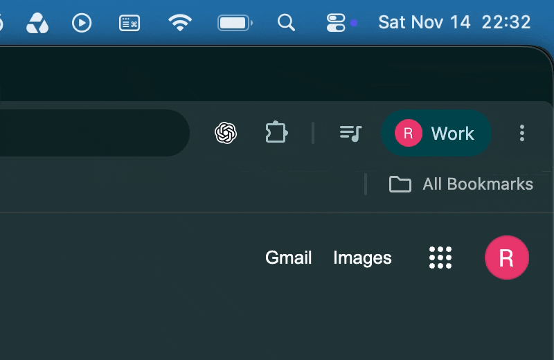

# Hook Me Up

Answer Claude Code from native macOS notifications. When Claude Code needs permission
for a tool, asks you a question, wants a plan approved or finishes a turn, Hook Me Up
shows a notification you can act on right there: approve or deny, pick an answer,
approve the plan or ask for changes. Click the notification to jump to the session.
It is built on Claude Code's hooks and fails open: if anything is off, Claude Code
simply shows its usual terminal dialog.



## Install

```sh
curl -fsSL https://raw.githubusercontent.com/robertodf99/hook-me-up/main/install.sh | bash
```

The installer downloads the latest release (and checks its SHA-256), installs
`~/Applications/Hook Me Up.app`, shows the changes it would make to
`~/.claude/settings.json` and **asks before writing them** (with a timestamped
backup), and starts the menu-bar agent at login. Run it again to upgrade.

Uninstall:

```sh
curl -fsSL https://raw.githubusercontent.com/robertodf99/hook-me-up/main/uninstall.sh | bash
```

It stops the agent, removes Hook Me Up's hooks from your settings (again after showing
the diff and asking), and removes the app. Your settings backups stay where they are.

Requirements: macOS 14 or later, and [Claude Code](https://docs.claude.com/en/docs/claude-code/overview).

### First run

Once the agent runs, the installer waits (up to a minute in a terminal, 10 seconds
without one) for you to answer macOS's question about notifications, shows a test
notification, and tells you what is left to do:

1. Allow notifications for **Hook Me Up** when macOS asks (or in System Settings →
   Notifications → Hook Me Up).
2. In the same place, set the style to **Alerts**, so requests stay on screen until
   you answer them. On a first install, the installer opens System Settings at
   Notifications when the style isn't Alerts yet; on an upgrade, only when
   notifications are off.
3. Restart Claude Code sessions that were already running, so they load the hooks.

## What you'll see

| When Claude Code… | Notification | Actions, in order |
|---|---|---|
| needs permission for a tool | `project · Needs permission`, with a plain-language summary and warnings such as "⚠︎ Leaves your machine" | Approve, Deny, Approve for session (when Claude Code suggests a session rule) |
| asks a question with up to four options | `project · Question` | One action per option, then Reply… for your own answer |
| asks a question with more options, or a multi-select one | `project · Question`, the options numbered in the body | Reply…: type `2`, `1, 3`, or an option's label |
| wants a plan approved | `project · Plan to approve`, with the first lines of the plan | Approve plan, Request changes… (your text goes back to Claude) |
| finishes a turn, or waits for a reply | `project · Finished` / `Waiting for your reply` | none |

- **Clicking a notification opens its session**: Terminal and iTerm2 select the exact
  tab. VS Code and Cursor (and VS Code Insiders and Windsurf) focus the open window that
  contains the folder Claude Code was started in: that folder's window, the window of
  the repository a worktree or subfolder belongs to, or a saved `.code-workspace` that
  includes it. While the session's window is open, a click opens no new window; when no
  open window contains the folder, the editor just comes to the front. The editor keeps
  its list of windows up to date with a delay, so right after you close windows a click
  may just bring the editor to the front. Zed and other apps come to the front.
  The click hands the request to Claude Code's terminal dialog: nothing is
  approved or answered from it. In a multi-question flow, the answers given so far are
  dropped and the terminal asks all the questions again.
- macOS shows the **first action as a button** and the others under **Options** when
  you hover the notification, so the most likely answer comes first.
- Several questions arrive one at a time; Claude gets all the answers after the last.
  A reply that can't be understood brings the question back with a hint.
- Answering needs an unlocked Mac, so nothing can be approved from the lock screen.
- Notifications are grouped per repository, play the default sound once, and
  disappear when the request is answered (here or in the terminal), cancelled, or the
  session moves on.

The ✻ menu-bar item shows how many requests are waiting and offers **Pause for 30
minutes**, **Resume** and **Quit**.

## How it works

```
Claude Code ──hook──▶ hook-me-up ──Unix socket──▶ Hook Me Up (menu-bar agent)
     ▲                    │                              │
     └──── decision ◀─────┘ ◀──────── your answer ◀──── native notification
```

Claude Code runs the `hook-me-up` command for `PermissionRequest`, `Notification`,
`Stop`, `UserPromptSubmit` and `SessionEnd`. For a permission request, the hook asks
the agent over a local socket and waits; the agent shows a notification and sends back
your decision, and the hook prints it for Claude Code. If there is no decision (the
agent isn't running, notifications are off, the agent is paused, something fails, or
the request times out), the hook prints nothing and Claude Code shows its own terminal
dialog. You can always answer in the terminal instead; the notification then goes
away. See [docs/ARCHITECTURE.md](docs/ARCHITECTURE.md) for the details.

## Security model

- **Fail-open.** The hook outputs a decision only when you made one. Errors never turn
  into an approval or a denial.
- **Local, same-user socket.** The socket lives in a private folder (`0700`, socket
  `0600`) and both sides check that the peer runs as the same user (`getpeereid`).
- **One answer per request.** Every request has its own id; the agent answers only on
  that request's connection, at most once, and the hook ignores any answer for another
  id. An action only counts if it belongs to the notification currently shown.
- **The hook builds the output.** Answers never carry tool input from the agent: the
  hook builds `updatedInput` from its own `tool_input`.
- **Session-only rules.** "Approve for session" keeps only rule and directory
  suggestions and always scopes them to the session; it never writes to your settings.
- **Unlocked Mac only** for every answering action.
- **Careful installer.** It verifies the package checksum, shows the settings diff and
  asks first, backs up, writes atomically, and refuses to write if the file changed
  meanwhile.
- **No content in logs.** `~/Library/Logs/hook-me-up.log` and the unified log
  (subsystem `io.github.robertodf99.hook-me-up`) hold event kinds and short ids only.

## Why macOS says "unidentified developer"

Hook Me Up is signed ad-hoc: it has no Apple Developer ID and is not notarized. A
Developer ID is a paid Apple membership, and this project won't buy one. What you see
because of that:

- System Settings → General → Login Items (Login Items & Extensions on newer macOS)
  lists Hook Me Up under **Allow in the Background**, marked as from an unidentified
  developer.
- When the installer starts the agent, macOS may show a notice that Hook Me Up added
  an item that can run in the background. That is the LaunchAgent that starts the
  agent at login.
- `codesign -dv ~/Applications/"Hook Me Up.app"` shows `Signature=adhoc`.

**Why the install isn't blocked.** Gatekeeper checks apps that carry the quarantine
flag (`com.apple.quarantine`), which browsers and other apps add to what they download.
`curl` doesn't add it, so the app the installer unpacks opens normally. The same zip
downloaded with a browser would be quarantined, and Gatekeeper would block the app from
opening.

**What to do.** Keep the Login Items entry enabled: turning it off stops the agent from
starting at login, and requests then go to the terminal dialog. Install with the script
rather than by downloading the zip in a browser. Or build it yourself from this
repository ([Building from source](#building-from-source)).

**How to check what you installed.**

- `codesign --verify --strict --deep ~/Applications/"Hook Me Up.app"` checks that no
  file changed since the package was signed. An ad-hoc signature can't tell you who
  signed it.
- The installer compares the zip with the `.sha256` file published in the same
  release. That catches a corrupted or cut-short download. It doesn't protect against
  a compromised account or release: whoever can replace the zip can replace its
  checksum too.
- Releases from v0.2.0 on carry a GitHub build provenance attestation, which ties the
  zip to the workflow run and the commit that built it:

  ```sh
  gh release download v0.2.0 --repo robertodf99/hook-me-up --pattern '*.zip'
  gh attestation verify hook-me-up-0.2.0-macos.zip --repo robertodf99/hook-me-up
  # Compare it with the installed app:
  ditto -x -k hook-me-up-0.2.0-macos.zip unpacked
  diff -r unpacked/HookMeUp.app ~/Applications/"Hook Me Up.app"
  ```

  This shows the zip was built by this repository's release workflow from that
  commit. It says nothing about what the code at that commit does: reading the source,
  or building it yourself, is still the strongest check.

## Configuration

The installer and uninstaller read these environment variables:

| Variable | Effect |
|---|---|
| `HOOK_ME_UP_VERSION=v1.2.3` | Install that release instead of the latest |
| `HOOK_ME_UP_YES=1` | Change `~/.claude/settings.json` without asking (non-interactive installs) |
| `HOOK_ME_UP_ZIP=<path>` | Install a local package (its `.sha256` must sit next to it) |
| `HOOK_ME_UP_NO_ONBOARDING=1` | Skip the notification check after starting the agent (no waiting, no test notification, System Settings stays closed) |

Example: `curl -fsSL …/install.sh | HOOK_ME_UP_YES=1 bash`. Without a terminal and
without `HOOK_ME_UP_YES=1`, the installer changes nothing in your settings and prints
the command to run.

To take a break, use **Pause for 30 minutes** in the menu bar: requests go to the
terminal until it ends or you choose **Resume**.

## Building from source

Requires Xcode 16 or later (Swift 6).

```sh
make            # build the hook, the installer CLI and the agent
make test       # unit tests
make lint       # swift format lint (make format to apply)
make app        # .build/HookMeUp.app
make install    # package this checkout and run install.sh with it
make uninstall  # run uninstall.sh
make dist VERSION=1.2.3 UNIVERSAL=1   # .build/dist/hook-me-up-1.2.3-macos.zip and .sha256
```

[docs/TESTING.md](docs/TESTING.md) lists the automated checks and a manual end-to-end
checklist. Pushing a `v*` tag publishes a release with GitHub Actions.

## Troubleshooting

Start with the doctor. It checks the app, the LaunchAgent, the running agent, the hooks in
`~/.claude/settings.json` and the notification settings, and says how to fix each
problem (it changes nothing itself):

```sh
~/Applications/"Hook Me Up.app"/Contents/MacOS/hook-me-up-setup doctor
```

- **No notifications.** Check System Settings → Notifications → Hook Me Up. While
  notifications are off, every request goes to the terminal and the log says how to
  turn them on.
- **Nothing happens at all.** Make sure the agent runs (✻ in the menu bar; else run the
  installer again) and restart your Claude Code sessions so they load the hooks.
- **The icon is out of date** after an upgrade. macOS caches it:

  ```sh
  /System/Library/Frameworks/CoreServices.framework/Frameworks/LaunchServices.framework/Support/lsregister -f ~/Applications/"Hook Me Up.app"
  killall NotificationCenter usernoted
  ```

  If it is still stale, log out and back in.
- **Login Items shows "unidentified developer".** Releases are signed ad-hoc; keep the
  item enabled. See [Why macOS says "unidentified developer"](#why-macos-says-unidentified-developer)
  for what that means and how to check what you installed.
- **Clicking a notification doesn't select the tab.** The first time, macOS asks to let
  Hook Me Up control Terminal or iTerm2; allow it in System Settings → Privacy &
  Security → Automation.

## Credits

The app icon is drawn from the Claude symbol on Wikimedia Commons (CC0 1.0); see
[THIRD_PARTY_NOTICES.md](THIRD_PARTY_NOTICES.md).

## License

[MIT](LICENSE)
