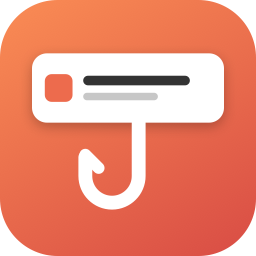
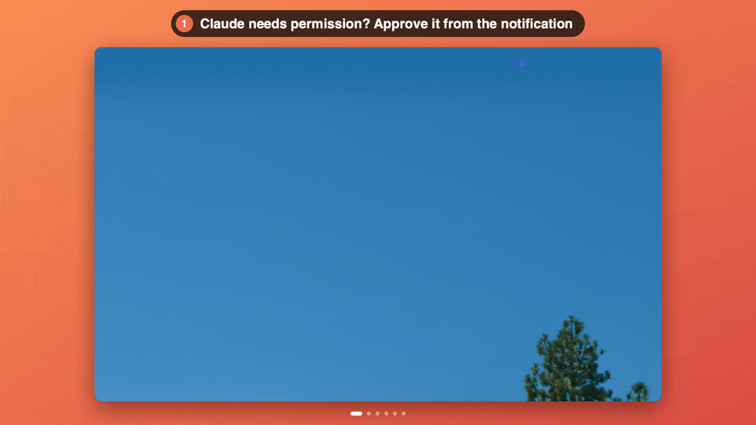

# Hook Me Up

<p align="center"></p>

Answer Claude Code and Codex CLI from native macOS notifications. Approve or deny
tool requests, see when a turn finishes, and click a notification to open its session.
Claude Code also supports answering questions and reviewing plans. Hook Me Up is built
on each CLI's hooks and fails open: if anything is off, the CLI shows its usual
terminal dialog. Codex support is opt-in; see [Codex CLI](#codex-cli).

Hook Me Up's app icon uses its blue/teal logo: a notification card with a fishing hook
hanging from it. Each session notification carries
a small client symbol: Claude's official symbol for Claude Code, OpenAI's black
Blossom for Codex. These identify the source; they are separate from our app icon.



The GIF still shows the previous visual identity; refreshing it needs new screen recordings.

## Install

```sh
curl -fsSL https://raw.githubusercontent.com/robertodf99/fde-toolkit/main/tools/hook-me-up/install.sh | bash
```

The installer downloads the latest release (and checks its SHA-256), installs
`~/Applications/Hook Me Up.app`, shows the changes it would make to
`~/.claude/settings.json` and **asks before writing them** (with a timestamped
backup), adds the [editor extension](#editor-extension) to VS Code, VS Code Insiders,
Cursor and Windsurf when it finds their command-line tool, and starts the menu-bar agent
at login. Run it again to upgrade.

Uninstall:

```sh
curl -fsSL https://raw.githubusercontent.com/robertodf99/fde-toolkit/main/tools/hook-me-up/uninstall.sh | bash
```

It stops the agent, removes Hook Me Up's hooks from your settings (again after showing
the diff and asking), and removes the app, its support folder and the editor extension
(with each editor's command-line tool it finds). Your settings backups stay where they
are.

Requirements: macOS 14 or later, and [Claude Code](https://docs.claude.com/en/docs/claude-code/overview)
or Codex CLI 0.172 or later.

### Install from Claude Code

Hook Me Up is also a Claude Code plugin with three commands that run the same installer
and ask for your confirmation in the chat:

```text
/plugin marketplace add robertodf99/fde-toolkit
/plugin install hook-me-up@fde-toolkit
```

(On Claude Code 2.1.275 or later, `/plugin install hook-me-up --marketplace robertodf99/fde-toolkit`
does both in one step.) Then:

- `/hook-me-up:install` installs or upgrades Hook Me Up: it shows the changes to
  `~/.claude/settings.json` and adds the hooks only after you say yes.
- `/hook-me-up:doctor` checks the installation and explains how to fix what is off.
- `/hook-me-up:uninstall` shows what would be removed and removes it after you say yes.

The plugin has commands only, no hooks: the hooks live in `~/.claude/settings.json` as
with the installer. Hooks inside the plugin would run in addition to those, and every
request would be notified twice.

### First run

Once the agent runs, the installer waits (up to a minute in a terminal, 10 seconds
without one) for you to answer macOS's question about notifications, shows a test
notification, and tells you what is left to do:

1. Allow notifications for **Hook Me Up** when macOS asks (or in System Settings →
   Notifications → Hook Me Up).
2. In the same place, set the style to **Alerts**, so requests stay on screen until
   you answer them. On a first install, the installer opens System Settings at
   Notifications when the style isn't Alerts yet; on an upgrade, only when
   notifications are off.
3. Restart Claude Code sessions that were already running, so they load the hooks.

## Codex CLI

To add Codex support **alongside Claude Code**, explicitly opt in:

```sh
curl -fsSL https://raw.githubusercontent.com/robertodf99/fde-toolkit/main/tools/hook-me-up/install.sh | bash -s -- --codex
```

The installer shows a separate diff for `$CODEX_HOME/hooks.json` (default
`~/.codex/hooks.json`), asks before writing it, backs it up and writes atomically.
It skips Codex if that profile folder doesn't exist, and never needs the Codex binary
on PATH. An older package without `--client` support skips Codex and tells you to
upgrade. Without `--codex`, installation leaves all Codex files untouched.

After installation, **review and approve the hooks with `/hooks` in Codex**. Until
trusted, they don't run. Hook Me Up never writes Codex's `config.toml`, `trusted_hash`
or trust state. Changing the hook command or moving its groups may require another
review in `/hooks`. Project hooks and hook definitions in `config.toml` are outside
this installer's scope.

| Codex event | What Hook Me Up does | Handler timeout |
|---|---|---|
| PermissionRequest | Approve or Deny from `project · Codex · Needs permission` | 600 s |
| Stop | `project · Codex · Finished`, with a gist of `last_assistant_message` when present | 10 s |
| UserPromptSubmit | Clear the session's notifications | 10 s |
| SessionEnd, Interrupt | Clear the session's notifications | 3 s |

**Codex waits for the hook before showing its approval dialog.** While a notification
waits, the terminal shows “Answer in the notification, or click it to answer here”.
Click the notification to focus the session and release the hook so Codex can show
its own dialog, or answer Approve / Deny in the notification. If nobody responds, the
hook returns without a decision after about 590 s. An unavailable agent, pause,
notifications off or a hook failure also returns without a decision; Codex then shows
its usual dialog. A managed policy may still require approval after an Allow.

Codex supports no “Approve for session”, question answers, plan approval or “Waiting
for your reply” notifications here. Its decisions contain only allow or deny (and a
message for deny). `apply_patch` summaries list paths from patch headers, warning on
writes outside the project. `codex exec` isn't distinguished in v1 and may show
“Finished”. This integration covers the CLI, not the Codex desktop app.

To remove both clients' hooks and the app:

```sh
curl -fsSL https://raw.githubusercontent.com/robertodf99/fde-toolkit/main/tools/hook-me-up/uninstall.sh | bash -s -- --codex
```

Without the flag, the uninstaller leaves Codex hooks untouched; if they still call
this app, it warns and keeps the app and agent installed. Backups remain beside each
client's hook file. `HOOK_ME_UP_YES=1` accepts both clients' diffs without prompting.

The doctor checks Codex hooks automatically, including duplicate handlers, the app
path, `[features] hooks = false` and a conflicting `[hooks]` table. Its trust line
is informational: review `/hooks` yourself. With no Hook Me Up hooks for Codex it
prints `INFO  Codex: not set up`. `doctor --home <folder>` isolates both clients;
`--codex-hooks <path>` checks another hooks file. The TOML checks cover standard table
syntax; they are text checks, not a full TOML parser or a query of effective policy.

## What you'll see

| When Claude Code… | Notification | Actions, in order |
|---|---|---|
| needs permission for a tool | `project · Needs permission`, with a plain-language summary and warnings such as "⚠︎ Leaves your machine" | Approve, Deny, Approve for session (when Claude Code suggests a session rule) |
| asks a question with up to four options | `project · Question` | One action per option, then Reply… for your own answer |
| asks a question with more options, or a multi-select one | `project · Question`, the options numbered in the body | Reply…: type `2`, `1, 3`, or an option's label |
| wants a plan approved | `project · Plan to approve`, with the first lines of the plan | Approve plan, Request changes… (your text goes back to Claude) |
| finishes a turn, or waits for a reply | `project · Finished` / `Waiting for your reply` | none |

- **Clicking a notification opens its session**: Terminal and iTerm2 select the exact
  tab. Ghostty (1.3 or later) focuses the terminal whose working directory is the folder
  Claude Code was started in. When several terminals are there (splits or tabs in the
  same folder), Hook Me Up briefly sets the title of the session's own terminal to a
  random marker, asks Ghostty which terminal shows it, puts the old title back and
  focuses that terminal; the title is back within about a second. When Ghostty doesn't
  show the marker in time (a fixed `title = …` in its config, or the session changed its
  title first), the title is cleared instead, so no marker is left behind (a title the
  session set meanwhile shows again when it next sets one), and Ghostty just comes to
  the front, as it does when the session has ended, when no terminal is in the folder, or
  when Ghostty's AppleScript is off (`macos-applescript = false`).
  Herdr Desktop focuses the session's terminal (including sub-agents) using the
  `HC_TERMINAL_ID` inherited from Herdr Core. Without a valid id, or if Herdr cannot
  focus it, Desktop just comes to the front.
  VS Code and Cursor (and VS Code Insiders and Windsurf) focus the open window that
  contains the folder Claude Code was started in: that folder's window, the window of
  the repository a worktree or subfolder belongs to, or a saved `.code-workspace` that
  includes it; with the [editor extension](#editor-extension), the session's integrated
  terminal is shown too, even when the window has several. While the session's window is
  open, a click opens no new window; when no open window contains the folder, the editor
  just comes to the front (and, with the extension, the front window shows the session's
  terminal if it has it). The editor keeps its list of windows up to date with a delay,
  so right after you close windows a click may just bring the editor to the front. Zed and
  other apps come to the front.
  The click hands the request to Claude Code's terminal dialog: nothing is
  approved or answered from it. In a multi-question flow, the answers given so far are
  dropped and the terminal asks all the questions again.
- macOS shows the **first action as a button** and the others under **Options** when
  you hover the notification, so the most likely answer comes first.
- Several questions arrive one at a time; Claude gets all the answers after the last.
  A reply that can't be understood brings the question back with a hint.
- Answering needs an unlocked Mac, so nothing can be approved from the lock screen.
- Notifications are grouped per repository, play the default sound once, and
  disappear when the request is answered here, cancelled, or the session moves on. A
  request you answer in the terminal goes away when the session finishes its turn or
  you send the next prompt, not at once.

The hook-shaped menu-bar item shows how many requests are waiting and offers
**Pause for 30 minutes**, **Resume** and **Quit**.

### Editor extension

VS Code can't be asked from outside which integrated terminal runs a session, so Hook Me
Up comes with a small extension for VS Code, VS Code Insiders, Cursor and Windsurf (plain
JavaScript, no dependencies; source in [editor-extension/](editor-extension/)). On a
click, the agent writes a request to
`~/Library/Application Support/hook-me-up/editor-focus-request.json`: a random id, the
time and the session's process ids, nothing else (no paths, titles or commands). Every
editor window watches that file; the window with a terminal whose process is one of those
ids shows it, and the others do nothing. Without the extension (or with it disabled), a
click works exactly as before: it focuses the window.

- The installer adds it with each editor's command-line tool (`code`, `code-insiders`,
  `cursor`, `windsurf`, on your `PATH` or inside the app in `/Applications` or
  `~/Applications`) and says so; if adding it fails, the install goes on. Set
  `HOOK_ME_UP_NO_EDITOR_EXTENSION=1` to skip it.
- Windows that were already open may need a reload (**Developer: Reload Window**) before
  the extension runs in them.
- The uninstaller removes it. You can also remove it from the editor's Extensions view
  (it is "Hook Me Up", id `hook-me-up.hook-me-up`).
- `hook-me-up-setup doctor` shows which editors have it (an INFO line; it never fails).
- Profiles: Hook Me Up checks the extension in the default profile's list (where the
  installer adds it). A window that uses another profile runs it only if that profile has
  it too; otherwise the click focuses that window as before.

## How it works

```
Claude Code ──hook──▶ hook-me-up ──Unix socket──▶ Hook Me Up (menu-bar agent)
     ▲                    │                              │
     └──── decision ◀─────┘ ◀──────── your answer ◀──── native notification
```

Claude Code runs the `hook-me-up` command for `PermissionRequest`, `Notification`,
`Stop`, `UserPromptSubmit` and `SessionEnd`. For a permission request, the hook asks
the agent over a local socket and waits; the agent shows a notification and sends back
your decision, and the hook prints it for Claude Code. If there is no decision (the
agent isn't running, notifications are off, the agent is paused, something fails, or
the request times out), the hook prints nothing and Claude Code shows its own terminal
dialog. You can always answer in the terminal instead; the notification then goes
away when the session finishes its turn or you send the next prompt. See
[docs/ARCHITECTURE.md](docs/ARCHITECTURE.md) for the details.

## Security model

- **Fail-open.** The hook outputs a decision only when you made one. Errors never turn
  into an approval or a denial.
- **Local, same-user socket.** The socket lives in a private folder (`0700`, socket
  `0600`) and both sides check that the peer runs as the same user (`getpeereid`).
- **One answer per request.** Every request has its own id; the agent answers only on
  that request's connection, at most once, and the hook ignores any answer for another
  id. An action only counts if it belongs to the notification currently shown.
- **The hook builds the output.** Answers never carry tool input from the agent: the
  hook builds `updatedInput` from its own `tool_input`.
- **Session-only rules.** "Approve for session" keeps only rule and directory
  suggestions and always scopes them to the session; it never writes to your settings.
- **Unlocked Mac only** for every answering action.
- **Clicks reach only the session's own terminal.** For Ghostty, the title marker is
  written only to the session's tty, and only while the session runs and that tty is
  still its controlling terminal (a character device of yours with the same device
  number, opened without following links); the marker is random, goes to Ghostty's
  AppleScript as an argument (never as script text), and the title written back has no
  control characters. The editor extension acts only on a request that is exactly what
  the agent writes: a file of yours in your private support folder, not a link, at most
  4 KiB, less than 5 seconds old, each id once, 1 to 16 process ids; it never writes the
  file, logs nothing and sends nothing anywhere.
- **Careful installer.** It verifies the package checksum, shows the settings diff and
  asks first, backs up, writes atomically, and refuses to write if the file changed
  meanwhile.
- **No content in logs.** `~/Library/Logs/hook-me-up.log` and the unified log (subsystem
  `io.github.robertodf99.hook-me-up`) hold event kinds and short ids only.

## Why macOS says "unidentified developer"

Hook Me Up is signed ad-hoc: it has no Apple Developer ID and is not notarized. A
Developer ID is a paid Apple membership, and this project won't buy one. What you see
because of that:

- System Settings → General → Login Items (Login Items & Extensions on newer macOS)
  lists Hook Me Up under **Allow in the Background**, marked as from an unidentified
  developer.
- When the installer starts the agent, macOS may show a notice that Hook Me Up added
  an item that can run in the background. That is the LaunchAgent that starts the
  agent at login.
- `codesign -dv ~/Applications/"Hook Me Up.app"` shows `Signature=adhoc`.

**Why the install isn't blocked.** Gatekeeper checks apps that carry the quarantine
flag (`com.apple.quarantine`), which browsers and other apps add to what they download.
`curl` doesn't add it, so the app the installer unpacks opens normally. The same zip
downloaded with a browser would be quarantined, and Gatekeeper would block the app from
opening.

**What to do.** Keep the Login Items entry enabled: turning it off stops the agent from
starting at login, and requests then go to the terminal dialog. Install with the script
rather than by downloading the zip in a browser. Or build it yourself from this
repository ([Building from source](#building-from-source)).

**How to check what you installed.**

- `codesign --verify --strict --deep ~/Applications/"Hook Me Up.app"` checks that no
  file changed since the package was signed. An ad-hoc signature can't tell you who
  signed it.
- The installer compares the zip with the `.sha256` file published in the same
  release. That catches a corrupted or cut-short download. It doesn't protect against
  a compromised account or release: whoever can replace the zip can replace its
  checksum too.
- Releases carry a GitHub build provenance attestation, which ties the
  zip to the workflow run and the commit that built it:

  ```sh
  version=0.5.0
  gh release download "hook-me-up-v$version" --repo robertodf99/fde-toolkit --pattern '*.zip'
  gh attestation verify "hook-me-up-$version-macos.zip" --owner robertodf99 \
    --signer-workflow robertodf99/fde-toolkit/.github/workflows/release.yml
  # Compare it with the installed app:
  ditto -x -k "hook-me-up-$version-macos.zip" unpacked
  diff -r unpacked/HookMeUp.app ~/Applications/"Hook Me Up.app"
  ```

  This shows the zip was built by this repository's release workflow from that
  commit. It says nothing about what the code at that commit does: reading the source,
  or building it yourself, is still the strongest check.

## Configuration

The installer and uninstaller read these environment variables:

| Variable | Effect |
|---|---|
| `HOOK_ME_UP_VERSION=1.2.3` | Install that version from its `hook-me-up-v*` tag (also accepts `hook-me-up-v1.2.3`) |
| `HOOK_ME_UP_YES=1` | Change `~/.claude/settings.json` without asking (non-interactive installs) |
| `HOOK_ME_UP_ZIP=<path>` | Install a local package (its `.sha256` must sit next to it) |
| `HOOK_ME_UP_NO_ONBOARDING=1` | Skip the notification check after starting the agent (no waiting, no test notification, System Settings stays closed) |
| `HOOK_ME_UP_NO_EDITOR_EXTENSION=1` | Don't add the [editor extension](#editor-extension) to VS Code, VS Code Insiders, Cursor or Windsurf |

Example:

```sh
curl -fsSL https://raw.githubusercontent.com/robertodf99/fde-toolkit/main/tools/hook-me-up/install.sh | HOOK_ME_UP_YES=1 bash
```

Without a terminal and without `HOOK_ME_UP_YES=1`, the installer changes nothing in
your settings and prints the command to run.

To take a break, use **Pause for 30 minutes** in the menu bar: requests go to the
terminal until it ends or you choose **Resume**.

## Building from source

Requires Xcode 16 or later (Swift 6). From the repository root, first run
`cd tools/hook-me-up` (or use `make -C tools/hook-me-up <target>`).

```sh
make            # build the hook, the installer CLI and the agent
make test       # unit tests
make lint       # swift format lint (make format to apply)
make app        # .build/HookMeUp.app (with the editor extension in Contents/Resources)
make vsix       # the editor extension alone: .build/hook-me-up.vsix
make install    # package this checkout and run install.sh with it
make uninstall  # run uninstall.sh
make dist VERSION=1.2.3 UNIVERSAL=1   # .build/dist/hook-me-up-1.2.3-macos.zip and .sha256
```

[docs/TESTING.md](docs/TESTING.md) lists the automated checks and a manual end-to-end
checklist. Pushing a `hook-me-up-v*` tag publishes a release with GitHub Actions.

## Troubleshooting

Start with the doctor. It checks the app, the LaunchAgent, the running agent, the hooks in
`~/.claude/settings.json` and the notification settings, and says how to fix each
problem (it changes nothing itself):

```sh
~/Applications/"Hook Me Up.app"/Contents/MacOS/hook-me-up-setup doctor
```

From Claude Code, run `/hook-me-up:doctor`.

The agent writes its log to `~/Library/Logs/hook-me-up.log`.

- **No notifications.** Check System Settings → Notifications → Hook Me Up. While
  notifications are off, every request goes to the terminal and the log says how to
  turn them on.
- **Nothing happens at all.** Make sure the agent runs (the hook icon in the menu bar;
  else run the installer again) and restart your Claude Code sessions so they load the hooks.
- **The agent's folder was deleted** (`~/Library/Application Support/hook-me-up`, say by
  a cleanup tool): the agent notices within about 5 seconds, creates it again and keeps
  listening (the log says `socket was removed or replaced; listening again`). Requests in
  between go to the terminal.
- **The icon is out of date** after an upgrade. macOS caches it:

  ```sh
  /System/Library/Frameworks/CoreServices.framework/Frameworks/LaunchServices.framework/Support/lsregister -f ~/Applications/"Hook Me Up.app"
  killall NotificationCenter usernoted
  ```

  If it is still stale, log out and back in.
- **Login Items shows "unidentified developer".** Releases are signed ad-hoc; keep the
  item enabled. See [Why macOS says "unidentified developer"](#why-macos-says-unidentified-developer)
  for what that means and how to check what you installed.
- **Clicking a notification doesn't select the tab.** The first time, macOS asks to let
  Hook Me Up control Terminal, iTerm2 or Ghostty; allow it in System Settings → Privacy &
  Security → Automation. With several Ghostty terminals in the session's folder, the log
  says why one wasn't picked (`ghostty: title marker not seen`, for instance when
  Ghostty's config sets `title`). In VS Code and the editors built on it, the terminal is
  shown only with the [editor extension](#editor-extension): check it with the doctor, and
  reload windows opened before it was installed.

## Feedback

Tried it? Tell me what worked and what broke in
[Feedback & ideas](https://github.com/robertodf99/fde-toolkit/discussions/1); questions go to
[Q&A](https://github.com/robertodf99/fde-toolkit/discussions/categories/q-a). For a bug,
[open an issue](https://github.com/robertodf99/fde-toolkit/issues/new/choose) with the output
of `hook-me-up-setup doctor`.

## Credits

The app icon and project images are original Hook Me Up drawings. Client symbols are
used only in notifications; sources and licences are in
[THIRD_PARTY_NOTICES.md](THIRD_PARTY_NOTICES.md).

Claude is a trademark of Anthropic; Codex and OpenAI are trademarks of OpenAI.
Hook Me Up is not affiliated with or endorsed by either company.

## License

[MIT](../../LICENSE)
